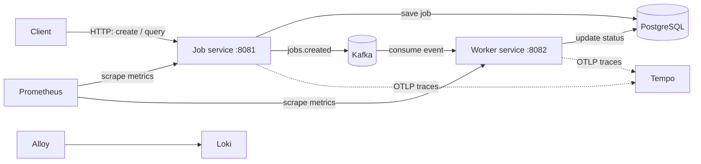

<div align="center">

# DistributedJobPlatform

### An event-driven platform for submitting and processing background jobs

<code>Java 21</code>
<code>Spring Boot 4.1.1</code>
<code>Maven</code>
<code>Kafka</code>
<code>PostgreSQL</code>

</div>

<div align="center">

| [Overview](#overview) | [Features](#features) | [Quick start](#quick-start) | [API](#api) | [Configuration](#configuration) | [Architecture](#architecture) | [Deployment](#deployment) |
|:---:|:---:|:---:|:---:|:---:|:---:|:---:|

</div>

## Overview

DistributedJobPlatform is a Java and Spring Boot application split into two services. The **job service** accepts job requests, saves them in PostgreSQL, and publishes a `jobs.created` event to Kafka. The **worker service** consumes that event, processes the job, and updates its status in the shared database.

The repository is a Maven multi-module project containing `job-service` and `worker-service`. Docker Compose also includes a local observability stack for metrics, dashboards, logs, and traces.

## Features

- Submit jobs and retrieve one job or the list of jobs through the job service.
- Persist job records and status in PostgreSQL.
- Dispatch work asynchronously through Kafka.
- Track job states: `PENDING`, `RUNNING`, `SUCCESS`, and `FAILED`.
- Expose Spring Boot health and Prometheus metrics endpoints.
- Run locally with Docker Compose or deploy the provided Kubernetes manifests.
- Scale the worker with Kubernetes HPA or KEDA Kafka-lag manifests.

> **Note:** The worker currently simulates processing: it waits about three seconds, and a payload equal to `fail` (case-insensitive) results in a `FAILED` status. This is sample processing behavior, not a general-purpose job execution engine.

## Quick start

### Prerequisites

- Docker with the Compose plugin
- Java 21 for local development and Maven verification

### Start the platform

From the repository root, start the services and supporting infrastructure:

```bash
docker compose up --build
```

When the containers are ready, the main service endpoints are:

| Service | Local address |
|---|---|
| Job service | `http://localhost:8081` |
| Worker service | `http://localhost:8082` |
| Prometheus | `http://localhost:9090` |
| Grafana | `http://localhost:3000` |
| Tempo | `http://localhost:3200` |
| Loki | `http://localhost:3100` |
| Alloy UI | `http://localhost:12345` |

PostgreSQL is published on host port `5434`, and Kafka on `9092`. Within Compose, the applications connect to Kafka at `kafka:9093` and PostgreSQL at `postgres:5432`.

To stop the stack, run `docker compose down`. The named database and Grafana volumes are retained.

### Verify the build

The repository CI uses the Maven wrapper with JDK 21:

```bash
./mvnw -B -ntp verify
```

On Windows, use `mvnw.cmd` with the same arguments.

## API

The job service exposes the following routes under `/api/jobs`:

| Method | Path | Description |
|---|---|---|
| `POST` | `/api/jobs` | Create a job from a JSON request with `type` and `payload` fields. |
| `GET` | `/api/jobs` | Return the jobs currently stored in the database. |
| `GET` | `/api/jobs/{id}` | Return the job with the given UUID. |

Create a job:

```bash
curl -X POST http://localhost:8081/api/jobs \
  -H "Content-Type: application/json" \
  -d '{"type":"example","payload":"hello"}'
```

The response contains the job `id`, `type`, `status`, and `createdAt`. Use the returned UUID to check its status:

```bash
curl http://localhost:8081/api/jobs/<job-id>
```

Creation initially returns a `PENDING` job. Kafka delivery and worker processing happen asynchronously, so query the job again to see its later status.

Health and metrics endpoints are exposed by both applications:

- `GET /actuator/health`
- `GET /actuator/prometheus`

## Configuration

The default application properties target local development dependencies. Docker Compose overrides the service connection addresses for container networking.

| Setting | Local application default | Docker Compose |
|---|---|---|
| Job service port | `8081` | `8081` |
| Worker service port | `8082` | `8082` |
| PostgreSQL URL | `jdbc:postgresql://localhost:5434/distributed_job_platform` | `jdbc:postgresql://postgres:5432/distributed_job_platform` |
| Kafka bootstrap servers | `localhost:9092` | `kafka:9093` |

The service settings are in `job-service/src/main/resources/application.properties` and `worker-service/src/main/resources/application.properties`. Compose configuration includes development-only credentials; provide appropriately managed credentials and configuration for any non-development deployment.

## Architecture



The job service persists a new job before publishing its event. Both services use PostgreSQL, and the worker looks up the job by the event's UUID before processing it. The current worker implementation is a simple simulated processor.

## Project structure

```text
.
├── job-service/             # Job HTTP API, persistence, and Kafka producer
├── worker-service/          # Kafka consumer and job processing
├── infrastructure/
│   ├── alloy/               # Log collection configuration
│   ├── loki/                # Log storage configuration
│   ├── prometheus/          # Metrics scrape configuration
│   └── tempo/               # Trace collection configuration
├── k8s/                     # Kubernetes services, workloads, and scaling
├── .github/workflows/       # CI and container image workflows
├── docker-compose.yml       # Local application and observability stack
├── pom.xml                  # Maven parent and module configuration
└── mvnw                     # Maven wrapper
```

## Deployment

The `k8s/` directory contains a namespace, PostgreSQL and Kafka resources, and deployments and services for both applications. Application deployments use one replica, `:latest` images, and `imagePullPolicy: Never`; the images therefore need to be available to the Kubernetes nodes before deployment. Readiness probes use `/actuator/health`.

Worker scaling examples are provided as both an HPA and a KEDA `ScaledObject` driven by Kafka consumer lag. The monitoring configurations live under `infrastructure/`. These manifests are starting points; adapt image delivery, credentials, persistence, and scaling settings to the target cluster before using them outside a development environment.

## Troubleshooting

| Symptom | Check |
|---|---|
| A locally run service cannot connect to PostgreSQL | Confirm PostgreSQL is reachable on host port `5434`. In Compose, the database port is `5432` on the `postgres` service name. |
| A locally run service cannot connect to Kafka | Use `localhost:9092` from the host. Containers use the Compose listener `kafka:9093`. |
| A job remains `PENDING` | Check that Kafka is running and the worker service is consuming the `jobs.created` topic; inspect the worker logs for processing errors. |
| A Kubernetes pod does not become ready | Check the pod logs and the `/actuator/health` readiness probe. Confirm the container image is present on the node because the manifests set `imagePullPolicy: Never`. |
| Metrics or traces are missing | Confirm the Prometheus, Tempo, and application containers are running and that the configured scrape and OTLP endpoints are reachable. |

## CI and project status

The GitHub Actions workflow runs Maven `verify` with JDK 21 and builds Docker images for both services. On pushes to `main`, it also publishes those images to GitHub Container Registry. The project version is `0.0.1-SNAPSHOT`.
